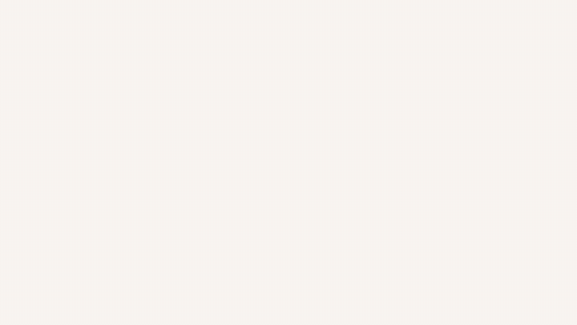
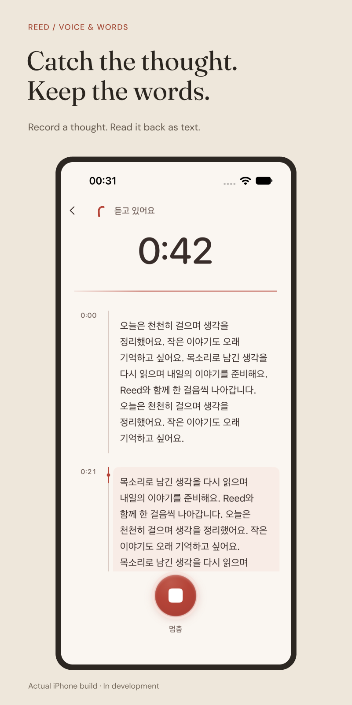

<strong>REED</strong>

<h1 align="center">Catch the thought. Keep the words.</h1>

A voice notebook for recordings you want to return to.

<a href="#from-a-moment-to-a-notebook">Explore the experience</a> · <a href="#development-status">Development status</a>

In development; not released. Animated product screenshots of English captures from an iPhone Simulator development build, with sample recordings, not user data. The word arrival is brand animation of live transcription. No sync is shown. <a href="assets/reed-promo-20261024.mp4">Watch the full film</a> · <a href="assets/reed-promo-20261024-poster.png">Still frame</a> · <a href="assets/reed-promo-20261024-manifest.json">Capture details</a>

## Some things are easier to say first

A thought on a walk. An explanation you want to hear again. Something you are not ready to write. REED gives that audio a place to live, with a transcript that helps you find your way back.

## From a moment to a notebook

**Capture it.** Record a thought or import an existing audio file.

**Read it back.** Follow the transcript alongside the recording.

**Return to the voice.** Play the audio again and keep it with your notes.

The original recording matters even when a transcript needs another attempt. Keeping the audio and making each recording's state clear are central to the product.

## Give the words room

Warm coral marks the recording controls; the surrounding interface stays quiet. The next design pass brings the library and transcript closer together, with clearer time markers and more readable text.

Approved Figma design · 15 October 2026 · Implementation in progress.

## My work on REED

REED is an independent product project. I shape the recording and reading experience, design the interface and build the application. The work follows a thought through its whole life in the app: capture, transcription, review and return.

## Development status

REED is in development for Mac and iPhone. A public download is not available here. Cross-device sync remains a future direction.

Which screens are working captures?

The hero campaign was composed in Figma around an actual iPhone development capture from 15 October 2026. Select it to inspect the original sample transcript; it contains no private conversation.

The library image is a separate, approved Figma design preview dated 15 October 2026. It shows the design direction, not a completed implementation. Features and availability may change during testing.

---

[More projects by Hyunjun Kim](https://github.com/EricEremos) · [Get in touch](https://www.linkedin.com/in/ericmos/)
