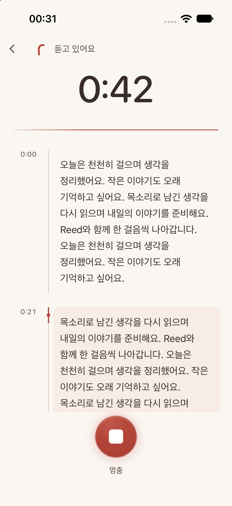
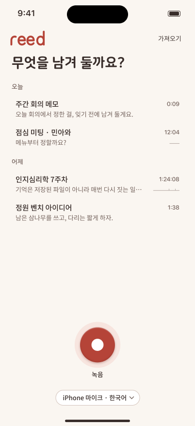

<strong>REED</strong>

<h1 align="center">Keep what was said.</h1>

A voice notebook for recordings you want to return to.

<a href="#from-a-moment-to-a-notebook">Explore the idea</a> · <a href="#development-status">Development status</a>

Actual iPhone development capture with a sample transcript. Preview of work in progress.

## Some things are easier to say first.

A thought on a walk. A conversation worth remembering. An explanation you want to hear again. REED gives that audio a place to live, with a transcript that helps you find your way back.

## From a moment to a notebook

### Capture

Record a thought or import an existing audio file.

### Read

Follow a readable transcript alongside the recording.

### Return

Play it back and keep the original audio with your notes.

The recording remains valuable even when transcription needs another attempt. REED is designed around keeping the original audio and making the state of each recording clear.

## The next design pass

The approved 15 October design brings the library and transcript closer together: clearer time markers, more readable text and quiet coral recording controls. These are Figma design previews; implementation is still in progress.

Approved design, 15 October 2026. A design preview, separate from the development capture above.

## Quiet enough to listen

Warm coral marks the recording controls; the rest of the interface gives the words room. The aim is a notebook you can read comfortably after the moment has passed.

This is one of my independent product projects: shaping the experience, building the application and refining the small details that make recording and reading feel connected.

## Development status

REED is in development for Mac and iPhone. This page is a product preview; a public download is not available here. Features and availability may change as the application is tested.

The development capture demonstrates the interface with sample content; the newer Figma export shows the approved design direction. It does not contain a private conversation. Cross-device sync is a future direction, rather than a feature promised by this preview.

---

[More projects by Hyunjun Kim](https://github.com/EricEremos) · [Get in touch](https://www.linkedin.com/in/ericmos/)
